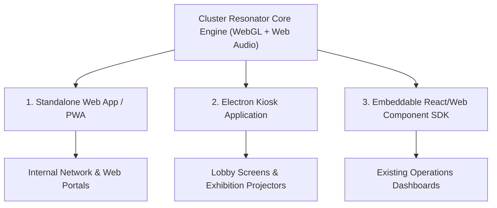

# EXECUTIVE PROPOSAL: CLUSTER RESONATOR
## Generative Data Sonification & Interactive Visual Installation Platform

> **Target Audience**: Creative Intelligence Department & Executive Leadership  
> **Project Code Name**: `MNusic / Cluster Resonator`  
> **Status**: Working Prototype & Architecture Validation Complete  

---

## 1. Executive Summary

**Cluster Resonator** is an enterprise-grade, generative data sonification and interactive visual environment. It bridges complex high-performance computing (HPC) infrastructure telemetry—such as MareNostrum 5 (MN5) and LUMI supercomputers—with generative ambient music (inspired by Brian Eno) and GPU-accelerated particle physics.

By transforming abstract server metrics (CPU, GPU, and Interactive node allocations) into an evolving acoustic and visual canvas, Cluster Resonator serves as both an **installation piece** for corporate headquarters/lobbies and a **cutting-edge prototype** for intuitive infrastructure monitoring.

---

## 2. Core Value Proposition & Use Cases

| Use Case | Description | Target Environment |
| :--- | :--- | :--- |
| **Corporate Lobby & Exhibition Installation** | A live, ambient visual and auditory installation reacting in real-time to internal compute cluster health and workload shifts. | HQ Lobbies, Technology Showrooms, Public Exhibitions |
| **Executive Monitoring Dashboard** | An organic alternative to traditional server dashboards. Provides passive acoustic awareness of system load without staring at numbers. | Executive Ops Centers, Innovation Labs |
| **Data Art & Experiential Marketing** | Showcases HPC computing power and creative intelligence capabilities to clients and partners through generative digital art. | Keynotes, Client Presentations, Trade Shows |

---

## 3. Key Technological Innovations

### 🎵 1. Web Audio FM & Additive Generative Synthesizer
* **Multi-Voice Generative Loop Engine**: 4 independent voice timers running non-coincident loop lengths (2.3s, 3.1s, 4.7s, 6.1s) to produce non-repeating, evolving ambient soundscapes.
* **Partition Acoustic Identities**:
  * **CPU Partition (Cyan)**: Dual-harmonic resonant wooden marimba sweep.
  * **GPU Partition (Gold)**: Heavy sub-bass FM thunder drop ($65\text{Hz} - 280\text{Hz}$).
  * **Interactive Partition (Rose)**: High-register crystal glass staccato cascade.
* **Organic Cluster Breathing**: Dynamic pitch detuning ($\pm 25$ cents) and tempo acceleration during "Inhale" phases, relaxing during "Exhale" phases.

### 🎨 2. Multi-Threaded Physics & Particle Engine
* **OffscreenCanvas Architecture**: Dedicated Web Worker (`worker.js`) executing spatial grid collision detection and volumetric ellipsoid particle rendering at 60 FPS without UI stutter.
* **Expanding Luminescent Circumferences**: Generative melodic notes trigger dual-layer expanding acoustic halo rings ($220\text{px}+$ radius) with flash luminescence blooms.

### 📊 3. Independent Multi-Band Telemetry Tracker
* **Decoupled Partition Buffers**: Independent telemetry histories for MN5 and LUMI supercomputers.
* **Multi-Band Auto-Scaling Graph**: Canvas visualization divided into 3 vertical bands (CPU, GPU, Interactive), ensuring all partition curves are clearly legible regardless of node scale differences.
* **Dynamic Random Evolution Mode**: Activated at 0% load; phase-walk algorithms drive dynamic, non-deterministic partition allocation shifts every 5 to 30 seconds.

---

## 4. Proposed Product Lineup & Deliverables



1. **Standalone Web App / PWA**: Hosted on internal servers; full offline PWA support and full-screen Kiosk mode.
2. **Desktop Kiosk Package (Electron/Tauri)**: Native desktop wrapper for single-click deployment on lobby displays and wall projectors.
3. **Embeddable SDK / Component**: Modular WebComponent/React wrapper for integration into corporate web suites.

---

## 5. Implementation Roadmap

```
Phase 1: Concept Validation (Completed)
└── Prototype development, sound engine calibration, multi-band telemetry graph, Random Mode.

Phase 2: Productization & Packaging (Next Step)
├── Refactor core engine into modular TypeScript / ES modules.
├── Build Electron Kiosk wrapper with native full-screen auto-launch.
└── Integrate WebSocket bridge for direct Slurm/Prometheus telemetry feeds.

Phase 3: Deployment & Showcase
├── Installation in corporate showroom/lobby.
└── Production release of internal web application.
```

---

*Document prepared for the Creative Intelligence Team. Code repository and interactive prototype available on branch `product-proposal`.*
