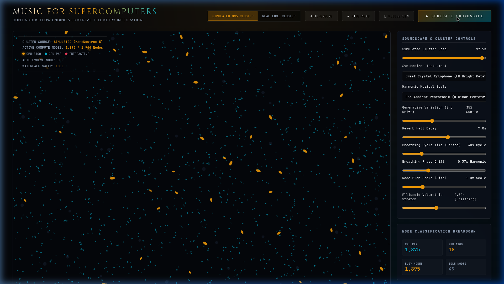

# 🎵 Music for Supercomputers (HPC Ambient Synthesizer)

> A real-time, high-fidelity generative ambient synthesizer and sonification resonator for High-Performance Computing (HPC) supercomputer clusters (MareNostrum 5 & LUMI).



---

## 🌟 Overview

**Music for Supercomputers** translates real-time supercomputer telemetry data into an evolving, exhibition-ready ambient soundscape. By mapping thousands of active compute nodes (CPU PAR, GPU A100, and Interactive partitions) onto dynamic Web Audio FM synthesizers, tape-loop phase drift algorithms, and 2D fluid particle physics, the application provides an immersive visual and auditory window into supercomputing cluster workloads.

---

## ✨ Features

- ** Dual-Mode Telemetry Ingestion**:
  - **Simulated MN5 Cluster Mode**: Interactive simulation model representing MareNostrum 5 (1,944 nodes).
  - **Real LUMI Cluster Mode**: Live Slurm telemetry parser fetching active vs. idle nodes directly from `cluster_node_status.txt` (4,315+ nodes).
- ** Crash-Proof OffscreenCanvas Web Worker**:
  - Offloads 60 FPS particle trajectory calculations, volume-conserving ellipsoid stretch transformations, and canvas rendering to an isolated Web Worker thread.
- ** Proportional Virtual Xylophone Waterfall**:
  - Triggers 1:1 glissando sweeps across the stereo pan field proportional to changes in busy node counts.
- ** Brian Eno-Inspired Generative Drift Engine**:
  - 4-voice asynchronous poly-phase tape loops with generative pitch mutation and micro-detuning.
- ** Dynamic Volumetric Stretch & Acoustic Breathing**:
  - Continuous compound sine-wave breathing animation that modulates note pitch ($\pm 12$ cents) and reverb decay duration in sync with visual ellipsoid morphing.
- ** Synchronized Node Luminescence**:
  - Acoustic note strikes trigger a bright white-gold luminescence flash at the exact center node blob from which expanding acoustic ripples originate.
- ** Generative AUTO-EVOLVE Engine**:
  - Autonomous background engine that periodically shifts instrument timbres, harmonic scales, and reverb decay settings over random intervals (1.5 to 4.0 minutes).
- ** Contemporary Responsive UI**:
  - Collapsible control sidebar for full-screen exhibition viewing, native browser fullscreen mode, and customizable sliders for blob scale, stretch factor, cycle period, and phase drift.

---

## 🚀 Quick Start & Installation

### Option 1: Run via Launcher Script (Recommended)

Simply execute `mnusic.sh` from your terminal or double-click it:

```bash
./mnusic.sh
```

This automatically starts a local web server at `http://127.0.0.1:8080/` and opens the application in your default web browser!

---

### Option 2: Manual Launch

1. **Launch a Local Web Server**:
   ```bash
   python3 -m http.server 8080
   ```

2. **Open in Browser**:
   Navigate to `http://127.0.0.1:8080/index.html` in Google Chrome, Firefox, or Edge.

4. **Start Audio Generation**:
   Click **`▶ GENERATE SOUNDSCAPE`** in the top right header to activate the audio engine.

---

## 🛰️ Real Telemetry Setup (LUMI Cluster)

To feed live Slurm cluster status into the synthesizer:
1. Run your background telemetry fetch script (`scripts/check_nodes.sh` or equivalent SSH loop) that periodically updates `cluster_node_status.txt` in the root directory.
2. In the application UI, click the **`REAL LUMI CLUSTER`** button in the header. The application will auto-poll `cluster_node_status.txt` every 5 seconds.

---

## 🛠️ Architecture & Controls

| Component | Description |
| :--- | :--- |
| **Synthesizer Timbres** | Crystal Xylophone, Wooden Marimba, Celestial Glass Bells, Vibraphone |
| **Harmonic Scales** | D Minor Pentatonic, Dorian Mode, Lydian Sci-Fi, Whole Tone, C Major Diatonic |
| **Breathing Controls** | Adjustable Cycle Period (5s–120s) & Phase Harmonic Drift (0.10x–1.00x) |
| **Visual Controls** | Node Blob Scale (0.4x–3.0x), Ellipsoid Volumetric Stretch (1.0x–3.0x) |

---

## 📜 License

Distributed under the MIT License. Feel free to adapt for exhibitions, data sonification research, or performance installations!
